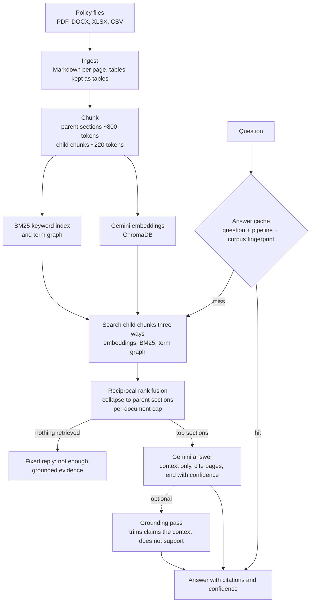

# Grounded BI

**Case study:** [sanaullahjannisar.com/work/grounded-bi](https://sanaullahjannisar.com/work/grounded-bi/), with the story, results and architecture. Built by [Sanaullah Jannisar](https://sanaullahjannisar.com), AI engineer.

Grounded BI answers HR policy questions from a folder of policy documents. Every answer cites the document and page it came from, ends with a confidence level, and says so plainly when the documents do not cover the question.

I built it against 65 public HR policy documents (677 pages, indexed into 1,214 chunks) from four levels: federal agencies, Wisconsin administrative code, the UW System, and UW Oshkosh HR. Those PDFs are not in this repo; [data/README.md](data/README.md) shows how to point it at your own.

**Status:** a local, single-workstation build. It has not been deployed, and no one outside the project has used it. The open items below come before any shared use.

## What an answer looks like

- Asked to compare federal and UW System guidance on FMLA and sick leave, it answered at Medium confidence with four page-level citations across both levels, listed what the evidence did not show, and took about 30 seconds the first time. A repeat of the same question comes from the answer cache with no model calls.
- Asked about pet insurance, which none of the documents cover, it answered with Low confidence and said the documents do not address it.

## How it works



**Retrieval.** Each question is searched three ways over the small child chunks: Gemini embeddings in ChromaDB, BM25 keyword scoring, and a term co-occurrence graph built at index time. The rankings are merged with reciprocal rank fusion, so an exact policy number found by keywords is not lost to a looser paraphrase match from embeddings. Hits are then collapsed to their larger parent section, so the model reads the full context around each passage, and a per-document cap keeps one long policy from filling the prompt. Follow-up questions in chat are rewritten into standalone questions before they are searched.

**Answer and refusal.** If retrieval finds nothing, the reply is a fixed sentence saying there is not enough grounded evidence, and no answer is generated. Otherwise the prompt tells Gemini to use only the retrieved context, say plainly when it is insufficient, never mention a source that was not provided, and end with `Confidence: High|Medium|Low`. Citations are built from the retrieved chunks' document names and page numbers, not from the model's text. An optional grounding pass sends the draft back with its context and removes claims the context does not support. It is off by default because it adds a second model call (5 to 23 seconds per question in my HR runs); turn it on with `TRBI_ANSWER_GROUNDING_ENABLED=1`.

**Cache.** Every stage is cached by content hash: extraction, chunks, embeddings and answers. The answer cache key includes the question, a fingerprint of the pipeline settings (models, chunk sizes, retrieval settings, version string) and a fingerprint of the corpus, so changing any of them invalidates old answers.

**Evaluation.** `bi-rag eval` runs a JSON file of questions through the full pipeline and scores each answer. Every answer cites all the chunks it was given, so a citation existing says nothing about support. Factual grounding and citation quality therefore check support claim by claim (`src/true_rag_bi/grounding_check.py`, no model call): the answer is split into sentences and bullets, and a claim counts as supported when one cited chunk contains at least 60% of its content words and every number in it. Factual grounding (1 to 5) comes from the share of supported claims; citation quality (1 to 5) from the share of cited chunks that support at least one claim. When a question carries `answerable`, `expected_doc`, `expected_pages` and `expected_facts`, the report also scores whether the expected page was retrieved, whether the key facts appear in the answer, and whether the system answered a covered question and declined one the documents do not cover. The check is lexical: it can miss a correct paraphrase and cannot catch a claim that reuses a chunk's words with the meaning reversed. Two more scores come from an LLM judge, a separate prompt to the same Gemini model that rates faithfulness to the retrieved context and relevance to the question, 1 to 5; a failed judge call is left out of the averages instead of counted as 0. Latency and cost are scored from the run's timings and token counts.

## Evaluation results

### HR library

The 50-question HR set was first run on 12 Oct 2026, with `gemini-2.5-flash` writing, grounding and judging the answers on the Gemini API free tier. The report is [eval/reports/hr_eval_20261012.md](eval/reports/hr_eval_20261012.md). With the grounding pass on:

- the expected page was among the cited chunks for 36 of the 40 covered questions;
- 33 of the 40 covered questions were answered and all 10 uncovered ones were declined;
- 99 of the 102 claims in the answers were supported by a cited chunk under the lexical check above;
- all expected facts appeared in 24 of the 40 answers. That is a lower bound, because the fact check does not credit paraphrases ("labor organizations" for "labor unions").

The grounding pass also removed a correct fact once, turning an answer into a decline. A run with the grounding pass off stopped after 44 questions, when the API began refusing the project (403). All 40 covered questions finished in both runs: off, 35 of 40 were answered and 102 of 109 claims were supported. Each figure is from one run, judged by the same model that answered, and the questions were written from the documents, not by HR staff.

### Earlier business-document runs

These runs were made before the switch to HR documents, on 16 questions over a fictional company's business documents.

| Run (22 Apr 2026, UTC) | Faithfulness (LLM judge) | Relevance (LLM judge) | What the report shows |
|---|---|---|---|
| 14:22 | 0.81 | 2.19 | 9 of 16 judge replies failed to parse and were scored 0 |
| 15:50 | 2.12 | 5.0 | no judge parse failures; all 16 answers served from the answer cache |
| 16:08 | 1.94 | 5.0 | all 16 answers again served from the cache |
| 16:19 | 3.31 | 5.0 | fresh answers with the grounding pass on: 14 kept as grounded, 2 trimmed |

Those runs used the earlier scoring, in which factual grounding (4.81) and citation quality (5.0) only checked that citations existed, so they scored the same in all four runs while the judge found unsupported details in most answers. That scoring has been replaced by the claim-level check above. In the last run one answer still named four competitors that appear nowhere in its sources. The second and third runs re-scored cached answers from an earlier pipeline version, so the drop from 2.12 to 1.94 is judge variation on the same answers, not a change in the system. Each figure is one run, judged by the same Gemini model that wrote the answers.

The reports themselves are not in this repo because they quote the earlier documents at length.

## Run it

Prerequisites: Python 3.12+, Node.js 18+, and a Gemini API key in `GEMINI_API_KEY`.

```powershell
python -m pip install -e ".[dev,api,formats,auth,export]"

# put documents in data/raw_pdfs/ (see data/README.md), then:
bi-rag index --verbose
bi-rag ask "How much FMLA leave can an employee take?" --debug
```

For the web app (FastAPI on port 8000, React on port 5173), see [RUNNING_THE_APP.md](RUNNING_THE_APP.md).

Tests run offline with no API key:

```powershell
python -m pytest -q
```

## Repo map

| Path | What it holds |
|---|---|
| `src/true_rag_bi/` | ingestion, chunking, indexing, retrieval, evaluation, CLI (`bi-rag`) |
| `api/` | FastAPI app: query, corpora, documents, search, eval, export and auth routers |
| `web/` | React and Vite front end: Ask, Chat, Library and Evaluation pages |
| `tests/` | pytest suite (70 tests) |
| `SYSTEM_OVERVIEW.md` | longer description of the pipeline |
| `ARCHITECTURE_DECISIONS.md` | an AI-written code review and the status of each finding |

## Open items

- **Auth.** Local dev sign-in is on unless `TRBI_DEV_AUTH_ENABLED=0`, and the session cookie is signed with a placeholder secret unless `TRBI_AUTH_SECRET` is set. Google and GitHub sign-in are wired but need your own OAuth client.
- **No OCR.** Scanned PDFs with no text layer come through as empty pages and are skipped at indexing.
- **Eval on the HR library.** `eval/hr_policy_questions.json` holds 50 questions for the HR documents: 40 with the document, page and key facts that answer them, and 10 the documents do not cover, 6 of them near misses. The facts were checked against the extracted page text. It has one run so far (see Evaluation results); `bi-rag eval --prompts eval/hr_policy_questions.json` runs it, at about two to three Gemini calls per question. On the free tier the calls need pacing, and that run's pacing harness is not in this repo. The questions were written from the documents, not by HR staff.
- **Grounding pass off by default** until its latency is acceptable.
- **No streaming.** Answers arrive whole; the CLI has no progress bar during indexing.

## Stack

Python 3.12, Gemini (`google-generativeai`) for embeddings, answers and judging, ChromaDB, pdfplumber, PyPDF2 and pdfminer.six, tiktoken, FastAPI, React 18, Vite, TypeScript.
